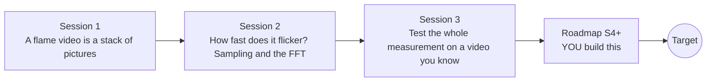

# openflame

[](https://github.com/KrunalPanchal1995/openflame/actions/workflows/ci.yml)   [](https://colab.research.google.com/github/KrunalPanchal1995/openflame/blob/main/sessions/session-01/lesson.ipynb) [](https://krunalpanchal1995.github.io/openflame/)

**Measure a flame from a phone video: height, flicker and how far to trust them.**

openflame teaches video measurement with a flame as the subject: from a brightness threshold, to the FFT of a height signal, to a full test on a synthetic video with error bars, using only Python and a browser.

- **Start from zero.** Session 1 needs only a ruler and a graph: a video is a stack of pictures and a threshold finds the flame.
- **See it move.** Every session ships a slider app that runs in the browser, with labelled graphs.
- **Know how far to trust a number.** Session 3 tests the whole method on a video whose answer you know, and gives an error bar.
- **Build the missing half.** The repo stops at Session 3 on purpose; the roadmap shows the path to the Target.

[Target](#the-target) · [Who is this for](#who-is-this-for) · [Quick start](#quick-start) · [Sessions](#sessions) · [Roadmap](#roadmap) · [Contribute](#contribute) · [Explainer PDF](docs/explainer.pdf)

> **This repo is incomplete on purpose.** Sessions 1 to 3 are here and fully working. The finished Target below is a preview of what the community can build next. We show you the path, not the code. Sessions 4 and up are yours.

## The Target

A synthetic flame video, with a glare halo, sway and travelling puffs, is measured frame by frame: the detected outline and tip are drawn on every picture, the extracted height trace grows next to the hidden truth, and its spectrum sharpens into a single peak at the flicker frequency, 2.74 Hz, with the Nyquist limit marked. Notice two things: the frequency comes out right to about 0.01 Hz, yet the mean height is about 20 mm too tall because the glare halo fools a simple threshold. Your goal over the coming sessions: build the measurement, then learn to correct what it gets wrong.


*Target: video, extracted height trace and its spectrum, measured live*

- [Math Visual Studio: aliasing, what a 24 fps camera does to a fast flicker (video)](promo/media/aliasing.mp4)

- [Math Visual Studio: flame height and the Heskestad correlation (video)](promo/media/flame_height.mp4)

- [The author's lab instrument on real footage: tip and width traced as the flame starts to flicker (video)](promo/media/seismograph_onset.mp4)

Try it live:

- [Math Visual Studio: aliasing of a puffing flame (Atlas S113)](https://krunalpanchal1995.github.io/studio/#atlas?ch=S113&ex=1)
- [Math Visual Studio: flame height and Heskestad (Atlas S117)](https://krunalpanchal1995.github.io/studio/#atlas?ch=S117&ex=1)
- [Math Visual Studio: the kymograph (Atlas S116)](https://krunalpanchal1995.github.io/studio/#atlas?ch=S116&ex=1)

How the Target was made is shown only as a path in [promo/roadmap.md](promo/roadmap.md).

## Who is this for
**higher secondary to advanced undergraduate (levels 4-6).** Topic area: Statistics, Research and Experimental Methods.

Prerequisites:

- Reading values off a graph; a little algebra. No physics of combustion is assumed.
- Python 3.10 or newer; if `python --version` works, you are ready. PRIMER.md explains the rest.
- No prior GitHub, signal processing or image processing experience is needed.

New to Python? Read [PRIMER.md](PRIMER.md) first (10 minutes).

## Quick start

No installation knowledge needed. You need [Git](https://git-scm.com/downloads) and [Python 3.10+](https://www.python.org/downloads/) (Windows: tick "Add Python to PATH"). On Mac and Linux type `python3` wherever this page says `python`.

```bash
git clone https://github.com/KrunalPanchal1995/openflame.git
cd openflame
python start.py 1
```

`start.py` creates a private environment, installs what is needed and runs Session 1 with its checkpoint. Next: `python start.py 2`, `python start.py 3`, or `python start.py test` to check everything. Only a checkpoint: `python start.py check 1`.

Four lines turn the idea of Session 2 into a result (they work as they are): Save it as `try.py` and run it with `python start.py run try.py` (this uses the private environment, where NumPy is installed):

```python
import numpy as np
fs = 30; t = np.arange(300) / fs                      # 10 s of video at 30 frames per second
h = 55 + 2 * np.sin(2 * np.pi * 2.74 * t)             # flame height in pixels, flickering at 2.74 Hz
f = np.fft.rfftfreq(len(h), 1 / fs); a = np.abs(np.fft.rfft(h - h.mean()))
print(round(float(f[a.argmax()]), 1), "Hz")            # -> 2.7 Hz  (the frequency grid steps by 0.1 Hz)
```

Every session also opens in your browser with sliders (no install): [live apps](https://krunalpanchal1995.github.io/openflame/). Or use the Colab badge above for the notebook.

## Sessions

| # | Session | Model level | Time | Live app |
|---|---|---|---|---|
| 1 | [A flame video is a stack of pictures](sessions/session-01/README.md) | Level 1: conceptual interactive model | 60 min | [open](https://krunalpanchal1995.github.io/openflame/session-01/) |
| 2 | [How fast does it flicker? Sampling and the FFT](sessions/session-02/README.md) | Level 2: mathematical engineering model | 75 min | [open](https://krunalpanchal1995.github.io/openflame/session-02/) |
| 3 | [Test the whole measurement on a video you know](sessions/session-03/README.md) | Level 3: simulation and validation | 90 min | [open](https://krunalpanchal1995.github.io/openflame/session-03/) |

Each session follows the same six steps: A real-world problem, B concept and theory, C visual explanation, D interactive simulation, E worked example and experiment, F assessment and design challenge. Each ends with `checkpoint.py`, which prints `PASS` or `FAIL` against reference numbers. Session 3 also contains the real-world mini-project: **Measure the flicker of a candle from a phone recording**.

## Architecture



| Folder or file | What is inside |
|---|---|
| `sessions/` | three sessions: README (A-F), `lesson.py`, notebook, live app, exercises, activity sheet, checkpoint |
| `promo/` | the Target: media, live links, and the roadmap (path only) |
| `docs/` | `explainer.tex` and the built `explainer.pdf` |
| `tests/` | runs every lesson and checkpoint headless |
| `start.py` | one command to set up and run anything |
| `QUALITY.md`, `RUBRIC.md` | the quality checklist and the scoring rubric |
| `.github/` | CI, PDF build, Pages deploy, issue and PR templates |

## Roadmap

| Milestone | What you will build | Difficulty |
|---|---|---|
| Session 4: Glare-corrected height | An extractor that estimates and subtracts the glare field before thresholding. | intermediate |
| Session 5: Resolve aliasing with two frame rates | A function that takes two measured apparent frequencies at two frame rates and returns the unique true frequency, or refuses. | intermediate |
| Session 6: The kymograph: convection speed | A kymograph builder and a stripe-slope estimator. | advanced |
| Session 7: Detect the onset of flicker | A sliding-window amplitude estimate with a change-point detector. | advanced |
| Session 8: A pipeline that refuses to guess | A measurement wrapper that reads timestamps, calibrates the scale from a ruler frame and refuses a frequency near the Nyquist limit. | advanced |

Full detail with a checkpoint per milestone: [promo/roadmap.md](promo/roadmap.md).

## Contribute
New to GitHub? Read [CONTRIBUTING.md](CONTRIBUTING.md); it starts from zero. Pick an issue labelled `good first issue`. Translations into Hindi, Telugu, Tamil and Malayalam are welcome.

<details>
<summary>Development</summary>

```bash
python start.py test        # runs every lesson and checkpoint
```
Lessons use `# %%` cell markers so they open as notebooks in VS Code. See [QUALITY.md](QUALITY.md) for the standard every session meets.
</details>

## License
MIT. See [LICENSE](LICENSE). Media in `promo/media` is (c) Krunal Panchal, CC BY 4.0.

## Acknowledgments
Part of the [PAN IIT OSS](https://hellofoss.tech-iitb.org/projects) open-source teaching collection, modelled on the structure of [openspline](https://github.com/openspline/openspline). Built on ideas from the Math Visual Studio at https://krunalpanchal1995.github.io/studio/.
