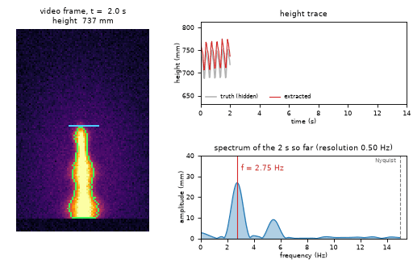

# What you are building toward

A synthetic flame video, with a glare halo, sway and travelling puffs, is measured frame by frame: the detected outline and tip are drawn on every picture, the extracted height trace grows next to the hidden truth, and its spectrum sharpens into a single peak at the flicker frequency, 2.74 Hz, with the Nyquist limit marked. Notice two things: the frequency comes out right to about 0.01 Hz, yet the mean height is about 20 mm too tall because the glare halo fools a simple threshold. Your goal over the coming sessions: build the measurement, then learn to correct what it gets wrong.

*Target: video, extracted height trace and its spectrum, measured live*

- [Math Visual Studio: aliasing, what a 24 fps camera does to a fast flicker (video)](media/aliasing.mp4)

- [Math Visual Studio: flame height and the Heskestad correlation (video)](media/flame_height.mp4)

- [The author's lab instrument on real footage: tip and width traced as the flame starts to flicker (video)](media/seismograph_onset.mp4)

These results come from a private reference build. The code is not published; the roadmap shows the path so you can build your own.

Live links:

- [Math Visual Studio: aliasing of a puffing flame (Atlas S113)](https://krunalpanchal1995.github.io/studio/#atlas?ch=S113&ex=1)
- [Math Visual Studio: flame height and Heskestad (Atlas S117)](https://krunalpanchal1995.github.io/studio/#atlas?ch=S117&ex=1)
- [Math Visual Studio: the kymograph (Atlas S116)](https://krunalpanchal1995.github.io/studio/#atlas?ch=S116&ex=1)
