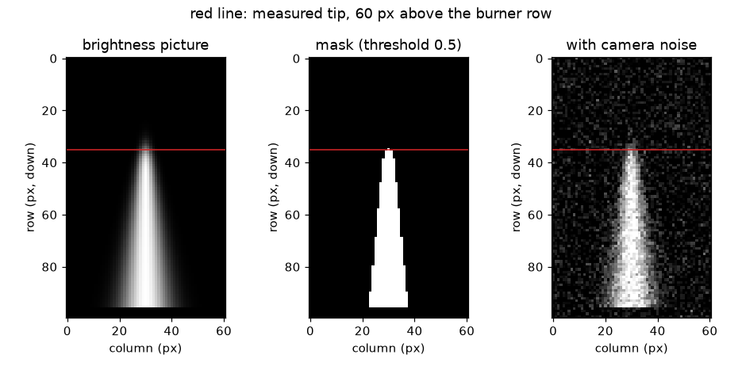
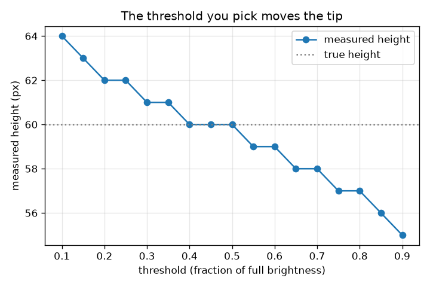

# Session 1: A flame video is a stack of pictures

*Level 1 (conceptual interactive model) · about 60 minutes · openflame*

> This is a simplified educational model. It is not a validated design tool and must not be used for real structures, electrical installations, vehicles, industrial processes or medical decisions.

**Prerequisites**

- Reading a number off a ruler and off a graph.
- You have read PRIMER.md and run `python start.py 1` once.

**Learning objectives.** After this session you can:

- Explain that a video is a stack of frames and each frame is a grid of brightness numbers.
- Turn a frame into a flame mask with a brightness threshold.
- Measure the flame height in pixels and convert it to millimetres with a scale.
- Explain why the chosen threshold changes the measured height.

## A. Real-world problem
You film a candle-sized or campfire-sized flame with a phone and ask: how tall is it? The flame never holds still, so a ruler and a stopwatch are no use. But a video is only many still pictures, and a computer can measure the same flame in every one of them. How does a computer decide which pixels are flame, and how does it turn pixels into millimetres? (This repo is general education about image measurement. Do not light fires to experiment unless an adult is present and it is safe.)

## B. Concept and theory
A grey-scale picture is a grid of numbers, one per pixel, from 0 (black) to 1 (white). A video is a stack of such grids, one per frame, so its array has shape (frames, rows, columns). A flame tip is not a sharp edge: the brightness fades over a few pixels. To measure a height we must therefore choose a threshold: a pixel belongs to the flame if its brightness is at least the threshold. Walking up the flame axis from the burner, the measured height is the last pixel that passes. If the brightness on the axis is a smooth fall-off with half-brightness point at height h and softness s, a threshold thr puts the tip at h + s ln((1 - thr)/thr): exactly h at thr = 0.5, higher for a lower threshold, lower for a higher one. A ruler beside the flame gives the scale in millimetres per pixel, which turns pixels into millimetres.

| Symbol | Meaning | Unit |
|---|---|---|
| h | true flame height: the height where the axis brightness is one half | px |
| z | height above the burner row, counted in pixels | px |
| s | softness of the tip (pixels over which the brightness fades) | px |
| thr | brightness threshold, as a fraction of full brightness | no unit |
| scale | millimetres per pixel (ruler length in mm divided by its length in px) | mm/px |
| H | measured flame height | px or mm |

**Assumptions**

- The camera does not move, and the picture is sharp enough that the tip fades over a few pixels.
- The background is dark (brightness 0 in Session 1; Session 3 removes this assumption).
- The flame is drawn by a simple formula: the picture is synthetic, so we know the true answer.
- The ruler and the flame are at the same distance from the camera (no perspective error).

$$ I(z)=\frac{1}{1+e^{(z-h)/s}}\qquad I(h)=\tfrac12 $$

$$ \text{flame pixel}\iff I\ge \mathrm{thr} $$

$$ z_{\mathrm{tip}}=h+s\ln\frac{1-\mathrm{thr}}{\mathrm{thr}} $$

$$ \mathrm{scale}=\frac{L_{\mathrm{ruler}}\ (\mathrm{mm})}{L_{\mathrm{ruler}}\ (\mathrm{px})},\qquad H_{\mathrm{mm}}=H_{\mathrm{px}}\times\mathrm{scale} $$

## C. Visual explanation
The first figure shows one synthetic frame, its mask at threshold 0.5, and a noisy version of the frame; a red line marks the measured tip, 60 pixels above the burner row. The second figure plots the measured height of the same 60 px flame against the threshold: it is 62 px at threshold 0.2, exactly 60 px at 0.5 and 57 px at 0.8. The curve falls because a higher threshold throws away the dim, fading top of the flame.

*One synthetic frame, its mask at threshold 0.5 and a noisy frame; the red line is the measured tip.*

*Measured height of a 60 px flame against the threshold: exact at 0.5, taller below and shorter above.*

## D. Interactive simulation
Run the lesson (`python start.py 1`), then open the live app: [Session 1: measure a flame from a picture](https://krunalpanchal1995.github.io/openflame/session-01/) (or `app.html` in this folder). Switch between the picture view and the brightness profile. Move the threshold and watch the mask shrink or grow and the red line move. Then change the true height, the softness and the scale, and see which of them changes the number of pixels and which only the millimetres.

**Challenge.** Make the measured height 40 mm (within 0.3 mm) on the ruler scale.

## E. Worked example and experiment
**Problem.** A ruler beside the flame is 100 px long in the picture and is 50 mm long. The flame in a frame has its half-brightness tip 60 px above the burner row. What height do you measure at threshold 0.5, in pixels and in millimetres? What would threshold 0.2 have given?

1. Scale = 50 mm / 100 px = 0.5 mm per pixel.
2. At threshold 0.5 the tip is at z = h + s ln(1) = 60 px, so the mask reaches 60 px above the burner row.
3. Height = 60 px x 0.5 mm/px = 30 mm.
4. At threshold 0.2 (s = 2 px) the tip is at 60 + 2 ln 4 = 60 + 2.77 = 62.77 px, and the last whole pixel that passes is 62 px = 31 mm.
5. Sanity check: a candle flame is a few centimetres tall, so 30 mm is plausible; the two thresholds differ by 1 mm, about the size of the tip's own fuzziness.

**Answer.** At threshold 0.5 the height is 60 px = 30 mm; threshold 0.2 would give 62 px = 31 mm.

**Experiment.** Photograph a steady candle flame beside a ruler (only with an adult present). Count the pixels from the wick top to the flame tip in an image editor at two brightness thresholds, and convert with the ruler. You will get two numbers a pixel or two apart. The model is exact because we drew the flame by a formula; a real tip also glows, flickers during the exposure, and is bright with a halo from the lens, so a real measurement needs an honest statement of the threshold used.

## F. Assessment and design challenge
**Question type A: Conceptual.** Why does a lower threshold give a taller flame? Is there a 'correct' threshold?

Hint

Where does the brightness at the tip go as you move up?

Step-by-step solution

The brightness fades gradually above the flame, so lowering the threshold lets dimmer, higher pixels count as flame. There is no single correct threshold: the flame has no sharp edge. A threshold is a definition. A good habit is to define the tip as the half-brightness point (threshold 0.5 between background and flame), and to always report the threshold with the height.

**Question type B: Numerical.** A ruler is 150 px long in the picture and 60 mm long in reality. A flame is 72 px tall at threshold 0.5. How tall is it in mm, and what is the uncertainty if the tip is uncertain by +-1 px?

Hint

scale = ruler length in mm divided by ruler length in px.

Step-by-step solution

scale = 60 / 150 = 0.40 mm/px. Height = 72 x 0.40 = 28.8 mm. An uncertainty of +-1 px is +-0.40 mm, so H = 28.8 +- 0.4 mm. Sanity check: the result is a few centimetres, the size of a candle flame.

**Question type C: Graph and simulation interpretation.** In the threshold figure, what height is measured at thresholds 0.2 and 0.8, and how many millimetres apart are they at 0.5 mm/px?

Hint

Read the two heights from the curve and subtract.

Step-by-step solution

At 0.2 the height is 62 px and at 0.8 it is 57 px. The difference is 5 px, which is 5 x 0.5 = 2.5 mm. The curve falls with increasing threshold and crosses the true height (60 px) at threshold 0.5.

**Question type D: Design and optimisation challenge.** Design: for a flame with true height 60 px and softness 2 px, which thresholds measure the height within +-1 px of the truth? Pick one and justify your choice, with noise in mind.

Hint

Solve 59 <= floor(60 + 2 ln((1 - thr)/thr)) <= 61 using predicted_height_px, or try values.

Step-by-step solution

Thresholds from about 0.27 up to 0.62 give 59 to 61 px (0.27 gives 61, 0.62 gives 59, 0.63 gives 58). Choose about 0.5: it is unbiased by construction, and it sits far from the dark background, so noise specks (which reach a low threshold such as 0.2 first) do not fool the count. Trade-off: a high threshold shortens the flame and loses its dim tip; a low one is easily fooled by noise and glare.

Score yourself with [RUBRIC.md](../../RUBRIC.md). Print the [activity sheet](activity_sheet.md) to work on paper.

## Common misconceptions
| Common misconception | What is actually true |
|---|---|
| A flame has one true height that a program simply finds. | The tip fades gradually; the height depends on the threshold. Define it (for example, half brightness) and report it. |
| Pixels are millimetres. | A pixel has no size until you put a ruler in the picture. The scale in mm per pixel converts pixels to millimetres. |
| More pixels always means a more accurate height. | Accuracy is limited by the blur of the tip, the threshold choice and the scale, not only by the number of pixels. |
| Camera noise is random so it cannot hurt the count. | A few bright noise pixels above the flame can add many rows to a naive count at a low threshold; the lesson counts only unbroken rows and can require more than one pixel per row. |

## Glossary
- **frame**: one still picture of a video
- **pixel**: one number in the picture grid: its brightness
- **threshold**: the brightness above which a pixel counts as flame
- **mask**: a picture of yes/no values: flame or not flame
- **scale**: how many millimetres one pixel covers, found with a ruler in the picture
- **height trace**: the flame height of every frame, plotted against time

## Finish
1. Do the three coding tasks in [exercises.md](exercises.md).
2. Run `python start.py 1` again after your changes. It ends with the checkpoint; when it prints `PASS`, you are done. (Checkpoint only: `python start.py check 1`.)

Next: [Session 2](../session-02/README.md)
