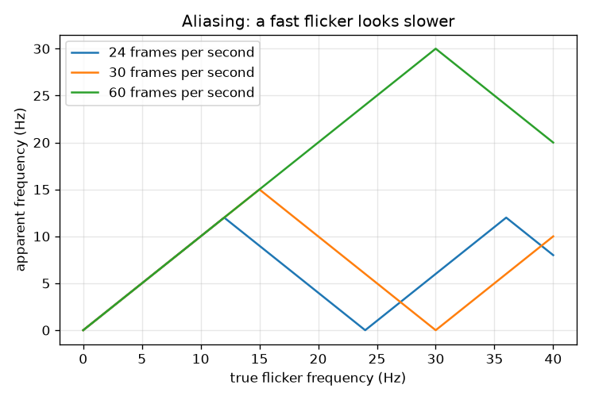
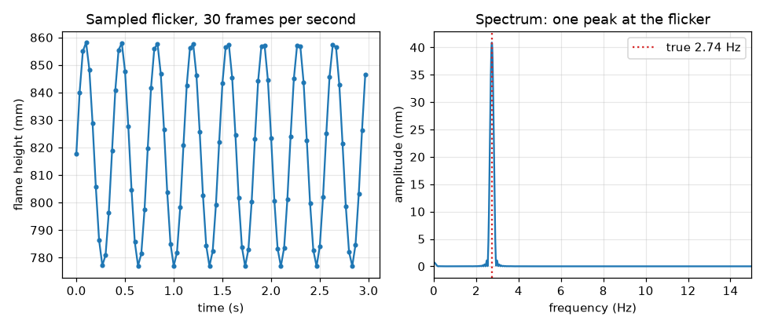

# Session 2: How fast does it flicker? Sampling and the FFT

*Level 2 (mathematical engineering model) · about 75 minutes · openflame*

> This is a simplified educational model. It is not a validated design tool and must not be used for real structures, electrical installations, vehicles, industrial processes or medical decisions.

**Prerequisites**

- Session 1: a height trace from a video.
- Sine waves and frequency in hertz (cycles per second).

**Learning objectives.** After this session you can:

- Find a flicker frequency by counting cycles and by the FFT of a height signal.
- State the resolution (1/T) and the Nyquist limit (fs/2) of a recording and compute an aliased frequency.
- Use the Heskestad flame-height and puffing-frequency correlations with correct units and state where they are valid.
- Choose a frame rate and recording length for a measurement.

## A. Real-world problem
A flame does not only have a height, it breathes: it grows and shrinks a few times a second (it is called puffing). A phone camera takes a snapshot every 1/30 of a second. Can 30 snapshots per second measure the breathing, and what is the fastest flicker the camera can see at all? A flame that flickers faster than the camera can follow does not disappear from the video: it shows up at a wrong, slower frequency. This is the same effect that makes a helicopter rotor or a wagon wheel look slow or backwards in a film.

## B. Concept and theory
Model the flame height as a steady mean plus a sinusoidal flicker, h(t) = h0 + A sin(2 pi f t). The camera sees it only at the frame times t = k/fs. We can estimate f in two ways. (1) Count cycles: the mean-removed signal crosses zero upward once per cycle, so f is the number of complete cycles divided by the time they took. (2) The Fourier transform splits the signal into sinusoids; a flicker appears as a peak in the amplitude spectrum, and a Hann window plus zero-padding gives a clean peak and a fine frequency grid. Two limits apply. A recording of T seconds cannot separate frequencies closer than 1/T hertz, so resolution improves with recording length, not with frame rate. And the highest frequency seen correctly is the Nyquist limit fs/2; a faster flicker f is aliased and appears at |f - m fs|, m being the whole number nearest to f/fs. Two published correlations give what to expect. Heskestad's correlation gives the mean flame height H of a turbulent buoyant diffusion flame (the height reached half of the time) from the heat release rate Q (kW) and the burner diameter D (m): H = 0.235 Q^(2/5) - 1.02 D. Pool fires puff at about f = 1.5/sqrt(D) hertz (D in m). Both are fits to experiments on pool fires and gas burners, not laws: use them for turbulent flames from a burner or pool of roughly 0.1 m across and larger, in still air, and expect scatter of tens of percent. They are not valid for small laminar flames such as a candle, for wind-blown or enclosed fires, or for the correlation outputs at very small Q (a negative H means the formula has left its range). This is a simplified educational model, not a fire-safety design tool.

| Symbol | Meaning | Unit |
|---|---|---|
| h(t) | flame height as a function of time | m or px |
| h0, A | mean height and flicker amplitude | same as h |
| f | flicker (puffing) frequency | Hz |
| fs | camera frame rate | frames per second (Hz) |
| T | length of the recording | s |
| N | number of frames, N = fs T | no unit |
| Q | heat release rate of the fire | kW |
| D | burner or pool diameter | m |
| H | mean flame height (Heskestad) | m |

**Assumptions**

- The flicker is a single steady sinusoid (a real flame is only roughly periodic).
- The frame rate is constant and each frame is an instantaneous snapshot (a real exposure averages over a few milliseconds, which weakens very fast flicker).
- Heskestad and the 1.5/sqrt(D) correlation hold for turbulent buoyant pool or burner flames of about 0.1 m diameter or more, in still air.
- The mean-removed signal is used: only changes in height matter for frequency.

$$ h(t)=h_0+A\sin(2\pi f t),\qquad t_k=k/f_s $$

$$ f\approx\frac{n_{\mathrm{cycles}}}{t_{\mathrm{last}}-t_{\mathrm{first}}} $$

$$ X(f)=\sum_{k=0}^{N-1} w_k\,(h_k-\bar h)\,e^{-i2\pi f k/f_s},\qquad \text{amplitude}=\frac{2|X|}{\sum w_k} $$

$$ \Delta f=\frac1T,\qquad f_{\mathrm{Nyq}}=\frac{f_s}{2},\qquad f_{\mathrm{alias}}=\left|f-m f_s\right|,\ m=\mathrm{round}(f/f_s) $$

$$ H=0.235\,Q^{2/5}-1.02\,D\qquad(H\ \mathrm{in\ m},\ Q\ \mathrm{in\ kW},\ D\ \mathrm{in\ m}) $$

$$ f\approx\frac{1.5}{\sqrt{D}}\qquad(f\ \mathrm{in\ Hz},\ D\ \mathrm{in\ m}) $$

## C. Visual explanation
The first figure shows the sampled height of a 0.30 m pool flame at 30 frames per second (left) and its spectrum (right): one sharp peak at 2.74 Hz, the red dotted line being the true value. The second figure is the aliasing map: apparent against true frequency for 24, 30 and 60 frames per second. Each curve follows the straight line up to its Nyquist frequency (12, 15 and 30 Hz), then folds back like a saw tooth and returns to 0 at the frame rate itself, where the flicker looks frozen. A 10.61 Hz flicker (a 0.02 m burner, outside the range of the correlation but a good test) appears at 4.39 Hz at 15 frames per second.

*Apparent against true flicker frequency for 24, 30 and 60 frames per second: the saw tooth of aliasing.*

*Sampled flicker of a 0.30 m pool flame (left) and its spectrum with the true 2.74 Hz marked (right).*

## D. Interactive simulation
Run the lesson (`python start.py 2`), then open the live app: [Session 2: flame height, flicker and the camera](https://krunalpanchal1995.github.io/openflame/session-02/) (or `app.html` in this folder). Start with the flame view and change the heat release rate and the diameter. Then open the samples view and raise the flicker frequency (by shrinking the diameter) until it exceeds half the frame rate: the red curve the samples imply separates from the true blue one. Finally read the aliasing map.

**Challenge.** Find a burner diameter and a frame rate for which the camera reports a frequency more than 1 Hz away from the true one.

## E. Worked example and experiment
**Problem.** A 0.30 m diameter pool fire releases 50 kW. Estimate the mean flame height and the puffing frequency. You film 10 s at 30 frames per second: how many frames, what resolution and what Nyquist limit? Is the flicker seen correctly?

1. Heskestad: 50^(2/5) = 4.7818, so 0.235 x 4.7818 = 1.1237 m.
2. Subtract 1.02 x 0.30 = 0.3060 m, so H = 0.8177 m = 0.818 m.
3. Puffing frequency: f = 1.5 / sqrt(0.30) = 1.5 / 0.5477 = 2.74 Hz.
4. Recording: N = 30 x 10 = 300 frames, resolution = 1/10 = 0.1 Hz, Nyquist = 30/2 = 15 Hz.
5. 2.74 Hz is far below 15 Hz, so it is seen correctly and the FFT peak sits within a fraction of 0.1 Hz of it. Sanity check: the flame is about 2.7 burner diameters tall, typical for a pool fire.

**Answer.** H = 0.818 m and f = 2.74 Hz; the clip has 300 frames, a 0.1 Hz resolution and a 15 Hz Nyquist limit, so the flicker is seen correctly.

**Experiment.** Film a steady, safe, supervised burner or a bonfire from a distance with a ruler in the picture at 30 frames per second for at least 10 seconds, extract the height trace as in Session 1 and take its FFT. Compare the peak with 1.5/sqrt(D) and the mean height with Heskestad's formula. Expect the same order of magnitude with scatter of tens of percent. Reasons for differences: the correlations are fits to many fires with scatter; wind, a rim, the fuel and the soot change the flame; the tip is a threshold choice; and real flicker is not a clean sinusoid.

## F. Assessment and design challenge
**Question type A: Conceptual.** A friend films a flame at 24 frames per second and sees a flicker at 9 Hz. Can she conclude the true flicker is 9 Hz?

Hint

Aliasing: which true frequencies would the camera report as 9 Hz?

Step-by-step solution

Not from this one video. Any true frequency |f - m x 24| = 9 Hz gives the same picture: 9, 15 (24 - 9), 33 (24 + 9), 39 (48 - 9) and so on. She can only be sure if she knows the flame cannot flicker faster than 12 Hz (the Nyquist limit), or if she films again at a different frame rate and the second apparent frequency is consistent with only one candidate.

**Question type B: Numerical.** A 0.05 m diameter burner puffs at about 1.5/sqrt(D). Calculate that frequency. At what frequency would a camera at 10 frames per second report it, and how does that compare with the Nyquist limit?

Hint

Nyquist is fs/2; use |f - m fs| with m = round(f/fs).

Step-by-step solution

f = 1.5 / sqrt(0.05) = 1.5 / 0.2236 = 6.71 Hz. The Nyquist limit at 10 fps is 5 Hz, so 6.71 Hz is aliased: m = round(0.671) = 1 and the apparent frequency is |6.71 - 10| = 3.29 Hz. (A 0.05 m flame is below the roughly 0.1 m range where the correlation was fitted, so treat 6.71 Hz as a rough guide.)

**Question type C: Graph and simulation interpretation.** In the aliasing map, what does a 24 frames per second camera report for a true 20 Hz flicker? Why does the curve return to 0 at 24 Hz?

Hint

Find 20 on the horizontal axis of the 24 fps curve.

Step-by-step solution

At 24 fps the curve is |20 - 24| = 4 Hz at a true 20 Hz. At a true 24 Hz the flicker repeats exactly once per frame, so every frame catches the flame at the same phase: it looks frozen (0 Hz).

**Question type D: Design and optimisation challenge.** Design: you want to measure the puffing frequency of pool fires with diameters from 0.1 m to 1 m to a resolution of 0.05 Hz. Choose a frame rate and a recording length and justify them.

Hint

The flicker frequencies are 1.5/sqrt(D) for the two ends. Resolution is 1/T. Allow a safety margin on the Nyquist limit.

Step-by-step solution

The frequencies are 1.5 / sqrt(0.1) = 4.74 Hz and 1.5 / sqrt(1) = 1.5 Hz. Resolution 0.05 Hz needs T >= 1 / 0.05 = 20 s. Nyquist must exceed 4.74 Hz, so fs > 9.5 Hz; a common 24 or 30 fps camera gives a margin of 2.5 to 3 times and also allows for harmonics. At 24 fps, 20 s is 480 frames. Trade-offs: a longer recording improves resolution only if the flame stays in the same state, and a higher frame rate costs storage and often exposure time without improving resolution.

Score yourself with [RUBRIC.md](../../RUBRIC.md). Print the [activity sheet](activity_sheet.md) to work on paper.

## Common misconceptions
| Common misconception | What is actually true |
|---|---|
| A higher frame rate gives a finer frequency resolution. | Resolution is 1/T and depends only on the recording length; the frame rate sets the Nyquist limit. |
| The tallest FFT peak is the exact frequency. | It is accurate only to the grid spacing 1/T (zero-padding makes the grid finer but adds no information); a parabola through the peak refines it. |
| The Heskestad and 1.5/sqrt(D) formulas are laws of nature. | They are fits to pool and burner fire experiments with scatter, valid for turbulent flames of about 0.1 m or more; a candle is outside the range. |
| If I see a clean peak in the spectrum, the frequency is right. | An aliased flicker also gives a clean peak, only at the wrong place; the frame rate must be high enough or a second frame rate must confirm it. |

## Glossary
- **frequency**: number of cycles per second, in hertz (Hz)
- **frame rate**: pictures per second taken by the camera, fs
- **FFT**: fast Fourier transform: splits a signal into sinusoids of different frequencies
- **Nyquist limit**: half the frame rate: the highest frequency seen correctly
- **aliasing**: a flicker above the Nyquist limit appearing at a wrong, lower frequency
- **resolution**: the smallest frequency difference a recording of T seconds can separate, 1/T
- **heat release rate**: the power released by the burning fuel, here in kW

## Finish
1. Do the three coding tasks in [exercises.md](exercises.md).
2. Run `python start.py 2` again after your changes. It ends with the checkpoint; when it prints `PASS`, you are done. (Checkpoint only: `python start.py check 2`.)

Next: [Session 3](../session-03/README.md)
