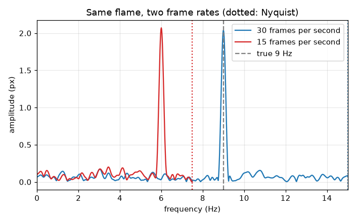
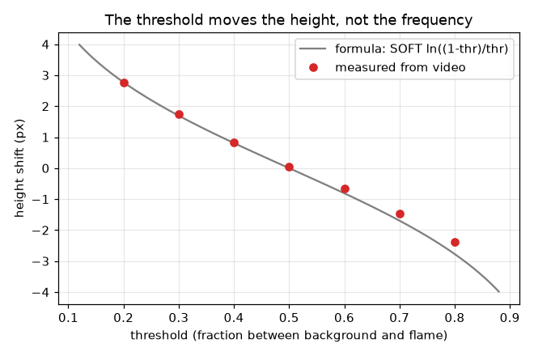
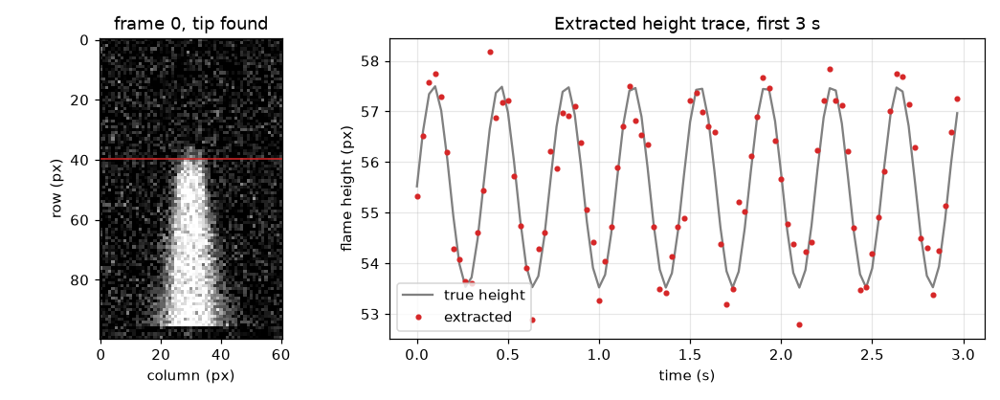

# Session 3: Test the whole measurement on a video you know

*Level 3 (simulation and validation) · about 90 minutes · openflame*

> This is a simplified educational model. It is not a validated design tool and must not be used for real structures, electrical installations, vehicles, industrial processes or medical decisions.

**Prerequisites**

- Session 1: threshold and height from a frame.
- Session 2: FFT, resolution, Nyquist limit and aliasing.

**Learning objectives.** After this session you can:

- Generate a noisy synthetic flame video with a known mean height and flicker.
- Extract the flame height automatically to a fraction of a pixel and recover the flicker with an error bar that you check against repeated experiments.
- Predict and observe aliasing when the frame rate is too low, and the threshold shift of the height.
- State when the method fails (low signal-to-noise) and which assumptions the error bar rests on.

## A. Real-world problem
Before you trust a measurement program on a real phone video you must test it on a video whose answer you already know. Is the extracted height right? How accurately is the frequency recovered, and what error bar should you quote? What happens when the frame rate is too low, or the threshold is chosen badly? In this session you build such a test video in code, run the full measurement on it, and break the method on purpose to see where it fails.

## B. Concept and theory
The test video has a known flame height h(t) = h0 + A sin(2 pi f t + phase) (the half-brightness tip) and random camera noise on every pixel. Extraction: average five columns around the flame axis, estimate the flame and background brightness from the whole video, put the threshold a fraction thr between them, walk up from the burner to the first height where three pixels in a row are below it, and interpolate in a straight line to get the tip to a fraction of a pixel. Then fit h0 + a sin + b cos by least squares at trial frequencies near the FFT peak and keep the best: that is the maximum-likelihood frequency for a sinusoid in white noise. Its error is bounded below by the Cramer-Rao bound, which depends on the amplitude A, the residual noise s of the height trace and the number of frames N, and falls as N^(-3/2). The threshold shifts the measured height by s_tip ln((1 - thr)/thr) but does not move the frequency. A frame rate below twice the flicker folds the flicker to an aliased frequency. The error bar assumes white Gaussian noise and a pure sinusoid; a real flame is neither, so a real error bar is larger. It also assumes the fit has found the right peak: when the flicker is weak compared with the noise, some runs lock onto a noise peak and the error bar is meaningless. This is a simplified educational model, not a validated instrument.

| Symbol | Meaning | Unit |
|---|---|---|
| h0, A | mean height and flicker amplitude of the synthetic flame | px |
| f | flicker frequency | Hz |
| fs, N | frame rate and number of frames | Hz, no unit |
| noise | standard deviation of the camera noise per pixel (full brightness is 1) | brightness units |
| s_tip | softness of the flame tip (2 px) | px |
| thr | threshold as a fraction between background and flame brightness | no unit |
| s | standard deviation of the height-trace residual after fitting | px |
| sigma_f | Cramer-Rao standard deviation of the frequency estimate | Hz |

**Assumptions**

- The camera noise is independent from pixel to pixel and from frame to frame (white).
- The flicker is a single steady sinusoid and the camera does not move.
- Each frame is an instantaneous snapshot; no rolling shutter, compression or automatic exposure.
- The flame axis is the middle column and a dim, flat background is visible above the flame.

$$ h(t_k)=h_0+A\sin(2\pi f t_k+\varphi),\qquad t_k=k/f_s $$

$$ z_{\mathrm{tip}}=h+s_{\mathrm{tip}}\ln\frac{1-\mathrm{thr}}{\mathrm{thr}} $$

$$ \sigma_f=f_s\sqrt{\frac{12}{(2\pi)^2\,\eta\,N(N^2-1)}},\qquad \eta=\frac{A^2}{2s^2} $$

$$ f_{\mathrm{alias}}=\left|f-m f_s\right|,\quad m=\mathrm{round}(f/f_s) $$

## C. Visual explanation
The first figure shows the first video frame with its detected tip (left) and the extracted height trace against the hidden truth for the first 3 seconds (right): the extracted dots follow the true curve to within 0.41 px (standard deviation), with no visible bias. The second figure shows spectra of the same 9 Hz flame filmed at 30 and at 15 frames per second: the 30 fps spectrum peaks at 9 Hz, the 15 fps one at 6 Hz, below its dotted Nyquist line at 7.5 Hz, which is the alias. The third figure plots the measured height shift against the threshold: the measured points follow the formula s_tip ln((1 - thr)/thr), from +2.75 px at threshold 0.2 to -2.39 px at 0.8, while the fitted frequency stays at 2.74 Hz for every threshold.

*The same 9 Hz flame filmed at 30 fps (peak at 9 Hz) and 15 fps (peak at the 6 Hz alias).*

*Measured height shift against the threshold follows the formula; the frequency does not change.*

*First video frame with the detected tip, and the extracted height trace against the hidden truth.*

## D. Interactive simulation
Run the lesson (`python start.py 3`), then open the live app: [Session 3: a synthetic video, its trace and its spectrum](https://krunalpanchal1995.github.io/openflame/session-03/) (or `app.html` in this folder). Raise the flicker frequency and the frame rate and watch the spectrum peak: it follows the true frequency while it is below the Nyquist line, and jumps to the alias above it. Add noise and watch the spectrum floor rise. Move the threshold and see the measured mean height shift while the peak does not.

**Challenge.** Make the camera report a frequency at least 2 Hz away from the true flicker.

## E. Worked example and experiment
**Problem.** A synthetic flame models a 0.30 m pool fire releasing 40 kW, seen by a camera with 13 mm per pixel at 30 frames per second for 8 s, with 2 px flicker amplitude at 2.74 Hz and camera noise 0.15. What mean height (in px) does Heskestad predict? What do the measurements give, and what error bar on the frequency does the formula promise for a residual height noise of 0.44 px?

1. Heskestad: 40^(2/5) = 4.3795, so H = 0.235 x 4.3795 - 1.02 x 0.30 = 1.0292 - 0.3060 = 0.7218 m = 722 mm.
2. In pixels: 722 mm / 13 mm per px = 55.5 px. This is the synthetic mean height h0.
3. The video has N = 30 x 8 = 240 frames. The pipeline gives a trace error of 0.41 px (standard deviation) and no bias (+0.05 px), a mean height of 55.56 px = 722 mm, an amplitude of 2.01 px and f = 2.7399 Hz.
4. Error bar by hand: eta = A^2 / (2 s^2) = 4 / (2 x 0.44^2) = 10.33; N(N^2 - 1) = 240 x 57599 = 1.382e7; (2 pi)^2 = 39.48; so sigma_f = 30 x sqrt(12 / (39.48 x 10.33 x 1.382e7)) = 30 x 4.61e-5 = 0.0014 Hz.
5. Result: f = 2.7399 +- 0.0013 Hz against the truth 2.74 Hz, within one error bar; the repeated experiments (30 noise seeds) scatter by 0.0013 Hz, matching the formula's 0.0014 Hz.

**Answer.** The measured mean height is 55.6 px (722 mm), matching Heskestad's 722 mm, and the frequency is 2.740 +- 0.0014 Hz; the error bar is confirmed by 30 repeated experiments.

**Experiment.** Film a real steady flame at 30 and, if your phone can, at 60 frames per second with a ruler, and run the same pipeline on both. The two frequencies should agree within their error bars if both are below their Nyquist limits. Expect a larger scatter than the formula gives: the real flame is not a pure sinusoid, the noise is not white (compression, auto-exposure, glare halos), and the tip depends on the threshold. The model is a clean best case: it tells you the smallest error bar you could hope for.

## Real-world application and mini-project: Measure the flicker of a candle from a phone recording
A phone recording of a small flame is 12 seconds at 30 frames per second. A ruler held beside the flame gives the scale. Use `candle_clip()` from Session 3 as a stand-in (a synthetic candle: 12 s, 30 fps, 0.5 mm per pixel) to build your program first. Then film your own flame only if an adult is present and it is safe to do so: fix the phone on a stand, lock exposure and focus, put a ruler beside the flame, record 12 seconds, extract frames with `ffmpeg -i clip.mp4 frames/f%04d.png`, crop them so the flame axis is the middle column, and read them with `frames_from_pngs`. A real candle in still air barely flickers, and a real clip is not a perfect sinusoid, so expect a larger scatter than the synthetic one.

**Deliverable:** A script that prints the mean flame height in mm, the flicker frequency with its error bar and the flicker amplitude in mm, repeats the measurement after keeping only every 2nd and every 3rd frame, and ends with a short paragraph saying which of the three frequencies you believe and why. For a real clip the paragraph must also say which assumptions of the error bar do not hold.

**Success looks like:** On the synthetic candle the script reports a height of 28.1 mm, a frequency of 7.300 Hz with an error bar below 0.002 Hz, and an amplitude of about 1.5 mm; the 15 fps version gives 7.30 Hz again (it is below its 7.5 Hz Nyquist limit), and the 10 fps version gives 2.70 Hz, the alias, which the paragraph must explain.

## F. Assessment and design challenge
**Question type A: Conceptual.** Why does changing the threshold shift the measured height but hardly change the measured frequency?

Hint

What does a threshold change in every frame, and what does frequency depend on?

Step-by-step solution

Changing the threshold moves the tip by about the same amount in every frame (s_tip ln((1 - thr)/thr) for a fixed tip shape), i.e. it adds a nearly constant offset to the whole height trace. Frequency depends on when the height rises and falls, not on its offset, so it is unchanged (the simulation shows 2.739 to 2.741 Hz for thresholds 0.2 to 0.8). The limit: an extreme threshold sits in the noise or inside the flame body and the extraction becomes unreliable.

**Question type B: Numerical.** Use the threshold formula for threshold 0.3 and s_tip = 2 px. How far does the tip move, in px and in mm at 13 mm per px? Is that a large part of the 722 mm flame?

Hint

shift = 2 ln((1 - 0.3)/0.3).

Step-by-step solution

shift = 2 ln(0.7/0.3) = 2 x 0.8473 = 1.69 px. In mm: 1.69 x 13 = 22 mm. That is 22/722 = 3 percent of the flame height, small but larger than the 0.4 px trace noise, so the threshold must be reported with the height.

**Question type C: Graph and simulation interpretation.** In the aliasing spectra figure, the 15 fps spectrum of a 9 Hz flame peaks at 6 Hz. Explain the position of the peak, and say what you would change in the experiment to see 9 Hz.

Hint

Compare 9 Hz with the Nyquist line of the 15 fps video.

Step-by-step solution

At 15 fps the Nyquist limit is 7.5 Hz and 9 Hz is above it, so it folds to |9 - 15| = 6 Hz, as the peak shows. To see 9 Hz you must film at more than 18 frames per second (30 fps works), or film at two different frame rates and check which true frequency is consistent with both.

**Question type D: Design and optimisation challenge.** Design: you need the flicker frequency to better than 0.01 Hz. At 30 frames per second the flicker amplitude is 1 px and the extraction noise 0.5 px. How long must the recording be? What else would you check?

Hint

Use frequency_error_bar(amp, resid_std, N, fs) for a few values of N and look for sigma_f below 0.01 Hz.

Step-by-step solution

frequency_error_bar gives 0.025 Hz for N = 60 (2 s), 0.0089 Hz for N = 120 (4 s) and 0.0031 Hz for N = 240 (8 s), so at least 4 s meets the target and 8 s gives a margin of three. Also check: the flicker must stay steady over the recording; the amplitude must be well above the noise (at a weak flicker some runs lock onto a noise peak and the formula no longer applies); the frequency must be below the Nyquist limit; and the real error bar is larger than the white-noise one, so a margin is wise.

Score yourself with [RUBRIC.md](../../RUBRIC.md). Print the [activity sheet](activity_sheet.md) to work on paper.

## Common misconceptions
| Common misconception | What is actually true |
|---|---|
| The Cramer-Rao error bar is the whole uncertainty of a real measurement. | It is the smallest error for white noise and a pure sinusoid. A real flame has irregular flicker, harmonics, drift and correlated noise, so the real uncertainty is larger. |
| Aliasing looks like noise or a bad measurement. | An aliased flicker gives a clean, sharp peak, only at the wrong frequency. Nothing in one spectrum tells you it is wrong. |
| Sub-pixel interpolation means the height is known to 0.01 px. | Interpolation removes the whole-pixel steps, but the noise (0.4 px here), the blur of the tip and the threshold still limit the accuracy. |
| A tall spectrum peak always means the program found the flicker. | When the flicker is weak compared with the noise the tallest peak may be a noise peak (12 of 30 runs in the failure experiment), so check the signal-to-noise first. |

## Glossary
- **synthetic video**: a video generated in code, so its true height and flicker are known
- **sub-pixel**: a position estimated to a fraction of a pixel by interpolation
- **least squares**: choosing the curve that makes the sum of squared differences smallest
- **Cramer-Rao bound**: the smallest possible spread of an unbiased estimate for a given noise level
- **signal-to-noise ratio**: flicker amplitude compared with the noise in the trace
- **decimate**: keep only every k-th frame, as if filmed at a lower frame rate

## Finish
1. Do the three coding tasks in [exercises.md](exercises.md).
2. Run `python start.py 3` again after your changes. It ends with the checkpoint; when it prints `PASS`, you are done. (Checkpoint only: `python start.py check 3`.)

Next: the [roadmap](../../promo/roadmap.md). Session 4 is yours to build.
